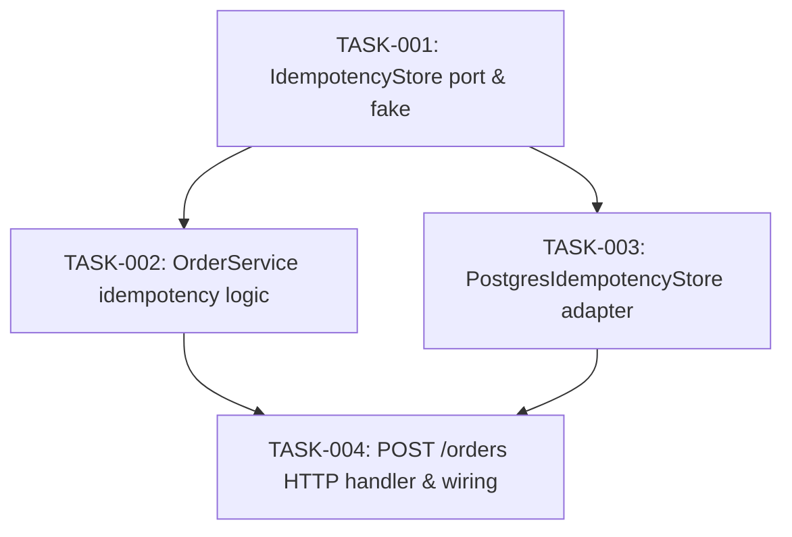

# Spec-Driven Development

Every feature and requirement change flows through linked artifacts in `specs/`:
**Requirements** (`REQ-*`) state what must be true, **Specifications** (`SPEC-*`)
define the concrete system behavior and contracts that satisfy those
requirements, **Plans** (`TASK-*`) organize implementation into a phased
dependency graph with explicit parallel branches, and **Notes** (`specs/notes.md`)
persist cross-phase decisions, constraints, and discoveries for future reference.

Never jump straight from a prompt to production code, and never advance from one
stage to the next while open decisions remain unresolved.

## 1. Commands

Recognize and execute these commands when invoked by the user (with or without a
leading `/`), and proactively guide the user through them:

| Command | Action |
| :--- | :--- |
| `spec flow <idea>` | **End-to-end pipeline.** Walks through the entire new-requirement-to-implementation lifecycle in sequence: (1) `req new`, (2) `spec req`, (3) `spec plan`, and (4) `spec implement` phase by phase — pausing after every stage with a recommended Conventional Commit and waiting for confirmation before advancing. |
| `req new <idea>` | **Define requirements.** Challenge and refine the user's idea via structured decision questions, then record new `REQ-###` entries (and any `Non-Goals`) in `specs/requirements.md` and durable context in `specs/notes.md`. |
| `req amend <REQ-ID> [change]` | **Tracked requirement revision.** Run a whole-project impact analysis, update `REQ-ID` in place while preserving the prior rule in an inline `> **Amended**` history block, cascade updates to affected `SPEC-###` entries, and generate a phased `TASK-###` plan for any code/test changes. |
| `req replace <REQ-ID> [change]` | **In-place requirement rewrite.** Run a whole-project impact analysis, overwrite `REQ-ID` in place as if it was always defined that way (no historical residue), prune obsolete notes, cascade updates to affected `SPEC-###` entries, and generate a phased `TASK-###` plan. |
| `spec req [REQ-ID]` | **Derive specifications from requirements.** Break the target `REQ-###` (or all unmapped requirements) into testable `SPEC-###` specifications in `specs/<area>.spec.md`, resolving design choices via structured decision questions. |
| `spec plan [SPEC-ID \| REQ-ID]` | **Plan implementation DAG.** Break approved `SPEC-###` items into atomic `TASK-###` tasks in `specs/plan.md` with a Mermaid dependency graph, sequential Phases (Waves), and explicit parallel groups. |
| `spec implement [Phase \| TASK-ID]` | **Execute planned tasks with parallel subagents.** Coordinate implementation wave by wave using subagents to plan and execute independent `Parallel Group` branches concurrently, integrate and verify each wave, update `specs/notes.md`, and stop at the phase commit checkpoint. |
| `spec adopt` (or `spec migrate`) | **Migrate an existing project to `specs/`.** Review the codebase, tests, and any prior spec/doc framework using parallel subagents, resolve domain boundaries and doc-vs-code drift via structured decision questions, synthesize `specs/requirements.md`, `specs/<area>.spec.md`, `specs/notes.md`, and `specs/plan.md` (for open work), clean up superseded spec files, and verify with `spec audit`. |
| `spec audit` | **Verify traceability.** Check `specs/` and the codebase for unmapped `REQ-###` items, orphan `SPEC-###` or `TASK-###` items, broken ID references, or drift between specs and tests. |

### Commit checkpoints (Conventional Commits)

At the completion of every command — and after each stage of `spec flow` or each
phase of `spec implement` — stop, propose a **Conventional Commit** message for
the staged changes, and **ask the user to confirm before running `git commit`**.
Never commit automatically without confirmation.

- Adoption / migration stage: `docs(specs): adopt spec-driven-development baseline`
- Requirements stage: `docs(specs): add REQ-001 idempotent order submission`
- Amendment stage: `docs(specs): amend REQ-001 retention window to 72h`
- Specification stage: `docs(specs): derive SPEC-001 from REQ-001`
- Planning stage: `docs(specs): plan implementation DAG for SPEC-001`
- Implementation phase: `feat(orders): implement Phase 1 idempotency store port (TASK-001)`

```markdown
**Ready to commit Stage 1 (Requirements):**
Proposed commit message:
`docs(specs): add REQ-001 idempotent order submission`

Files to stage: `specs/requirements.md`, `specs/notes.md`
Would you like me to commit these changes and proceed to `spec req REQ-001`?
```

## 2. Artifact layout and traceability

Store all specification artifacts in a central `specs/` directory at the
repository root:

- `specs/requirements.md` — single canonical registry of all project
  requirements (`REQ-001`, `REQ-002`, …) and explicit non-goals.
- `specs/<domain-or-feature>.spec.md` — specifications (`SPEC-001`, `SPEC-002`,
  …) grouped by domain or feature area.
- `specs/plan.md` (or `specs/plans/<change-slug>.md` for targeted changes) —
  phased implementation plan (`TASK-001`, `TASK-002`, …) and dependency graph.
- `specs/notes.md` — persistent project memory capturing cross-phase decisions,
  domain/codebase constraints, phase handoffs, and deferred items.

**Strict traceability chain.** Every `SPEC-###` lists the `REQ-###` IDs it
satisfies (`Requires: REQ-001, REQ-003`). Every `TASK-###` lists the `SPEC-###`
IDs it implements. Orphan specs (no backing `REQ-###`), unmapped requirements
(a `REQ-###` with no `SPEC-###` once `spec req` is complete), and unanchored
tasks (no `SPEC-###`) are forbidden.

## 3. Structured question-asking protocol

At every stage — `req new`, `spec req`, `req amend`, `req replace`, `spec plan`,
and `spec adopt` — challenge vague, incomplete, or conflicting inputs before
writing or updating artifacts. Never silently guess on ambiguous scope, and
never ask open-ended "what would you like?" questions when concrete design
choices exist.

Every question presented to the user must follow this exact structure:

1. **Decision** — the specific ambiguity, constraint, or boundary to resolve,
   and why it matters.
2. **Options and trade-offs** — each viable choice with its concrete pros,
   cons, and downstream impact on complexity, operations, or other requirements.
3. **Recommended option** — the best choice listed first and prefixed with
   `(Recommended)`, stating why it fits the project's constraints.

```markdown
### Decision: <Short title of the choice to make>
<1–2 sentences explaining the ambiguity or conflict and what it affects.>

1. **(Recommended) <Option A>** — <Summary of approach>
   - *Pros:* <Concrete benefit>
   - *Cons / Trade-offs:* <Cost, constraint, or limitation>
2. **<Option B>** — <Summary of approach>
   - *Pros:* <Concrete benefit>
   - *Cons / Trade-offs:* <Cost, constraint, or limitation>
```

Keep iterating until all decisions for the current stage are resolved, then
write or update the artifact, update `specs/notes.md`, and present the
Conventional Commit checkpoint.

## 4. Persistent note-taking and phase memory (`specs/notes.md`)

Requirements state *what*, specs state *contracts*, and plans state *tasks* —
none of those files should be cluttered with background commentary. Yet critical
knowledge surfaces during questioning, impact analysis, and implementation that
future phases and future sessions need. Persist that knowledge in
`specs/notes.md`.

**Rules for `specs/notes.md`:**

- **Read before every command, update before every commit checkpoint.** Always
  read `specs/notes.md` before starting any `req` or `spec` command so prior
  decisions and constraints are honored. Update it before proposing the stage's
  Conventional Commit.
- **Anchor every note to an ID (`REQ-###`, `SPEC-###`, `TASK-###`, or `Phase N`).**
  Unanchored notes rot; linking to IDs makes it obvious which notes must be
  reviewed or pruned when a requirement is revised.
- **Curate state, never keep an append-only diary.** `specs/notes.md` is a
  living reference, not a chat transcript. When a `Phase Handoff` note is
  consumed and resolved in the next phase, delete or fold it into a constraint;
  when `req replace` rewrites a requirement, remove notes that only applied to
  the replaced behavior.

Organize `specs/notes.md` into four sections:

1. **Decisions & Trade-offs (`DEC-###`)** — Distilled outcome of structured
   decision questions: what was chosen, what was rejected, and the constraint
   that drove it, so future work does not re-litigate settled choices.
2. **Domain & Technical Constraints** — Non-obvious codebase invariants,
   external API quirks, performance budgets, or legacy limitations discovered
   during research or implementation.
3. **Active Phase Handoffs** — Concrete facts produced in one implementation
   phase that downstream phases need (for example, shared test fixtures created,
   edge cases uncovered, or adapter wiring prerequisites).
4. **Deferred / Parking Lot** — Valid ideas, edge cases, or follow-ups surfaced
   during any phase that were intentionally scoped out of the current cycle.

```markdown
# Project Spec Notes & Memory

## Decisions & Trade-offs
- **DEC-001 (REQ-001, SPEC-001):** Store idempotency keys in Postgres rather
  than Redis. *Why:* Order creation already runs in a Postgres transaction;
  keeping key + order insert atomic avoids a two-phase commit across stores.

## Domain & Technical Constraints
- **[SPEC-001]:** Partner webhooks retry with exponential backoff up to 48h on
  `5xx` responses, but stop immediately on `422`.

## Active Phase Handoffs
- **[Phase 1 -> Phase 2 (TASK-001)]:** `FakeIdempotencyStore` and the shared
  `anIdempotencyStoreContract` suite live in `src/testing/idempotency.fixture.ts`;
  import from there in `TASK-002` and `TASK-003`.

## Deferred / Parking Lot
- **[REQ-001]:** Background pruning job for expired idempotency keys (>72h)
  deferred until table exceeds 1M rows.
```

## 5. Stage 1 — Define and challenge requirements (`req new`)

When the user proposes a new capability (`req new` or Step 1 of `spec flow`):

- **Challenge the requirement before recording it.** Probe for hidden
  assumptions, missing actors, boundary conditions, failure modes, scale or
  security constraints, and conflicts with existing `REQ-###` entries. If the
  user states an implementation detail as a requirement ("use a Redis queue"),
  ask for the underlying need ("survive process restarts and process within 5s")
  and record the need.
- **State *what* and *why*, never *how*.** A requirement describes an observable
  truth, invariant, or constraint from the user's or system boundary's
  perspective — never internal classes, framework APIs, or storage schemas.
- **Make every requirement verifiable.** Ban vague adjectives ("fast",
  "intuitive", "robust"). Replace them with checkable criteria or deterministic
  rules.
- **Record explicit non-goals and decision notes.** Anything ruled out belongs
  in `## Non-Goals` in `specs/requirements.md`; key trade-offs resolved during
  questioning belong in `specs/notes.md`.

```markdown
### REQ-001: Idempotent order submission
Submitting the same order payload with an identical `Idempotency-Key` within 24
hours must return the original order result without creating a duplicate charge
or inventory reservation.
```

## 6. Stage 2 — Derive specifications (`spec req`)

When running `spec req [REQ-ID]` (or Step 2 of `spec flow`), break agreed
requirements into concrete specifications in `specs/<area>.spec.md` and iterate
with the user on any design choices using the structured question protocol:

- **Define boundary behavior and contracts.** Each `SPEC-###` specifies inputs,
  outputs, domain invariants, state transitions, error cases, and edge
  conditions required to satisfy its linked `REQ-###` IDs.
- **Include testable acceptance criteria.** Write concrete scenarios
  (`Given / When / Then` or checkable assertions) that map directly to unit and
  integration test cases.
- **Respect architectural boundaries.** Specs define ports, contracts, and
  observable behavior without locking in incidental implementation details that
  belong inside a single function.

```markdown
### SPEC-001: Order submission idempotency contract
**Requires:** REQ-001

**Behavior:**
- Requests to `POST /orders` require a non-empty `Idempotency-Key` header (max
  128 ASCII characters); missing or malformed keys fail with `400 invalid-idempotency-key`.
- A repeat request with the same key and identical payload hash within 24h
  returns the stored status code and body without invoking payment or inventory
  ports.
- A repeat request with the same key but a different payload hash fails with
  `422 idempotency-key-payload-mismatch`.

**Acceptance Criteria:**
- Given a completed order with key `K1`, when `POST /orders` is called again
  with `K1` and the same payload within 24h, then the original response is
  returned and `PaymentPort.charge` is called once in total.
- Given a completed order with key `K1`, when `POST /orders` is called with `K1`
  and a modified item quantity, then `422 idempotency-key-payload-mismatch` is
  returned.
```

## 7. Stage 3 — Plan development as a dependency graph (`spec plan`)

When running `spec plan` (or Step 3 of `spec flow`), break approved
specifications into atomic tasks (`TASK-###`) organized into sequential
**Phases (Waves)** and an explicit **Dependency Graph (DAG)** so execution order
and parallel workstreams are unmistakable:

- **Every task is atomic and independently verifiable.** A task produces a
  testable increment (a port + fake + contract test, a domain behavior + unit
  tests, an adapter, or a wiring step) and states how completion is verified.
- **Identify parallel branches explicitly.** Tasks whose `Depends On` lists are
  satisfied and that touch disjoint modules must be grouped into parallel
  streams within the same Phase/Wave rather than serialized arbitrarily.
- **Render both a Mermaid DAG and a Phased Task Table.** The Mermaid `graph TD`
  visualizes task dependencies and parallel branches; the table is the
  execution checklist.

````markdown
## Dependency Graph



## Implementation Phases

### Phase 1 — Core Contracts (Foundation)
| ID | Task | Specs | Depends On | Parallel Group | Verification |
| :--- | :--- | :--- | :--- | :--- | :--- |
| TASK-001 | Define `IdempotencyStore` port, `FakeIdempotencyStore`, and contract test suite | SPEC-001 | — | Stream A | Contract suite passes against fake |

### Phase 2 — Domain & Infrastructure (Parallel Branches)
| ID | Task | Specs | Depends On | Parallel Group | Verification |
| :--- | :--- | :--- | :--- | :--- | :--- |
| TASK-002 | Implement key lookup, payload-hash check, and replay in `OrderService` | SPEC-001 | TASK-001 | Stream A (Domain) | Unit tests for replay and `422` mismatch |
| TASK-003 | Implement `PostgresIdempotencyStore` adapter | SPEC-001 | TASK-001 | Stream B (Infra) | Contract suite passes against Postgres |

### Phase 3 — Composition & Delivery
| ID | Task | Specs | Depends On | Parallel Group | Verification |
| :--- | :--- | :--- | :--- | :--- | :--- |
| TASK-004 | Wire header validation and idempotency store into `POST /orders` | SPEC-001 | TASK-002, TASK-003 | Stream A | End-to-end handler tests pass |
````

## 8. Stage 4 — Execute implementation with subagents and parallelism (`spec implement`)

When running `spec implement [Phase | TASK-ID]` (or Step 4 of `spec flow`), act
as the orchestrator across the dependency graph in `specs/plan.md` and use
subagents to plan and execute work intelligently and in parallel:

- **Use subagents for parallel codebase scouting and task design.** Before
  writing code in a phase that touches multiple subsystems, dispatch read-only
  research subagents in parallel to inspect existing module boundaries, test
  fixtures, and conventions for each stream so implementation starts with exact
  file paths and zero guesswork.
- **Execute each Phase (Wave) by fanning out parallel subagents.** Within the
  active Phase, inspect the `Parallel Group` column and `Depends On` graph:
  - When a Phase has a single stream (such as a foundational contract in Phase
    1), execute it directly or with a single focused subagent.
  - When a Phase contains multiple independent streams (`Stream A`, `Stream B`,
    …) whose `Depends On` tasks are complete, launch concurrent worker
    subagents — one subagent per parallel stream or independent `TASK-###` — so
    disjoint branches of the DAG are built simultaneously rather than serially.
- **Enforce disjoint write scopes before fanning out.** Never assign two
  concurrent subagents to edit the same file, shared barrel export, or migration
  index at the same time. If two parallel tasks need a shared type, port, or
  test builder, extract that shared seam into the preceding wave (or create it
  in the coordinator before spawning the subagents).
- **Give every subagent a self-contained spec briefing.** Each subagent prompt
  must include:
  1. Its assigned `TASK-###` ID(s), description, and `Verification` command/check
     from `specs/plan.md`.
  2. The full text and acceptance criteria of the linked `SPEC-###` and
     `REQ-###` entries.
  3. Relevant entries from `specs/notes.md` (`DEC-###` decisions, domain
     constraints, and `Active Phase Handoffs` such as shared fakes or contract
     suites created in earlier phases).
  4. The exact files/directories it owns (and which files are off-limits), with
     instructions to implement test-first (TDD) and report back verification
     results plus any new handoff notes for downstream phases.
- **Join, verify integration, update notes, and checkpoint after each wave.**
  Once all parallel subagents in the active Phase complete:
  1. Review their diffs and run the project's full test, lint, and build suite to
     verify the parallel branches integrate cleanly with zero warnings.
  2. Consolidate any new discoveries or shared utilities reported by the
     subagents into `specs/notes.md` (`Active Phase Handoffs` or `Domain &
     Technical Constraints`), and prune handoff notes that were consumed in this
     wave.
  3. Present the **Conventional Commit checkpoint** for the completed Phase and
     wait for user confirmation before committing and launching the next wave.

## 9. Stage 5 — Revise requirements (`req amend` vs. `req replace`)

Revising an existing requirement after specifications or code exist requires a
full impact analysis and an explicit choice of revision mode. Never edit a
`REQ-###` in isolation without checking what depends on it.

### Step 1: Confirm the revision mode (`Amend` vs. `Replace`)

If the user asks to change a requirement without specifying `req amend` or
`req replace`, ask using the structured question protocol:

- **Amend (`req amend <REQ-ID>`):** Updates `REQ-###` to the new rule while
  preserving the previous definition and the reason for the change in an inline
  `> **Amended**` blockquote directly beneath the requirement. Use when
  preserving the history of *why* the rule changed prevents future regressions
  or re-litigation.
- **Replace (`req replace <REQ-ID>`):** Overwrites `REQ-###` in place as if it
  had always been defined the new way, leaving no historical note in
  `specs/requirements.md` and pruning superseded entries in `specs/notes.md`.
  Use when fixing a mistaken requirement, simplifying scope, or pivoting where
  the old phrasing would only add noise.

Never mint a new `REQ-###` ID just to modify an existing requirement unless the
requirement is genuinely splitting into two independent requirements.

```markdown
### REQ-001: Idempotent order submission
Submitting the same order payload with an identical `Idempotency-Key` within 72
hours must return the original order result without creating a duplicate charge
or inventory reservation.

> **Amended 2026-11-07:** Retention window extended from 24 hours to 72 hours
> to cover weekend retry backoffs from partner webhooks.
> - *Previous:* Submitting the same order payload with an identical
>   `Idempotency-Key` within 24 hours must return the original order result
>   without creating a duplicate charge or inventory reservation.
```

### Step 2: Run a whole-project impact analysis

Before applying a requirement change, inspect the entire repository (using
parallel research subagents when the codebase or spec suite is large) and
present a structured **Impact Analysis** covering all three layers:

1. **Requirements impact (`specs/requirements.md`):** Identify any other
   `REQ-###` entries or Non-Goals that conflict with, duplicate, or are
   narrowed/widened by the revised requirement.
2. **Specifications impact (`specs/*.spec.md`):** Locate every `SPEC-###` that
   lists `Requires: REQ-###` (plus any other spec touching the same domain
   concepts) and list the exact contracts, state transitions, or acceptance
   criteria that must be updated, added, or removed.
3. **Code and test impact (codebase):** Search the codebase for the modules,
   ports, adapters, schemas, routes, and unit/integration tests implementing
   the affected `SPEC-###` entries, and list what existing code and tests will
   break or need migration.

If the impact analysis reveals design choices or trade-offs (for example,
backward compatibility vs. clean break, or data migration strategy), resolve
them with the user using the structured question protocol before editing files.

### Step 3: Cascade updates to specs, notes, and the implementation plan

Once the revision and its cross-project impacts are confirmed:

1. Apply the **Amend** or **Replace** edit to `specs/requirements.md` and update
   `specs/notes.md` (recording new `DEC-###` entries or pruning replaced notes).
2. Update all affected `SPEC-###` entries in `specs/*.spec.md` so the
   specifications reflect the new truth (specs always state current behavior;
   do not clutter specs with old behavior unless backward compatibility is part
   of the requirement).
3. When the revision requires code, test, or migration work, create or update
   the implementation plan (`specs/plan.md` or `specs/plans/<revision-slug>.md`)
   with a Mermaid dependency graph and phased `TASK-###` table — planning the
   requirement change with the exact same phased, parallel-branch rigor as a
   new feature, followed by a Conventional Commit checkpoint.

## 10. Adopting or migrating an existing project (`spec adopt` / `spec migrate`)

When running `spec adopt` or `spec migrate` on an existing repository — whether
it uses another specification framework (such as OpenSpec, SpecKit, ADRs, PRDs,
or scattered `docs/`) or has no specs at all — migrate the project into `specs/`
in four steps:

### Step 1: Parallel discovery of existing docs and live code

Dispatch read-only research subagents in parallel to inventory the repository:

1. **Existing spec or planning artifacts:** Search for prior spec directories,
   ADRs, RFCs, PRDs, `README.md`, agent configs (`CLAUDE.md`, `AGENTS.md`), and
   `TODO` / roadmap files to extract previously stated requirements, design
   rationale, non-goals, and in-flight work.
2. **Implemented capabilities and contracts:** Inspect domain modules, public
   entrypoints/routes, ports and adapters, database schemas, and the test suite
   to map the bounded contexts, behaviors, invariants, and edge cases the system
   actually enforces today.

### Step 2: Reconcile drift and confirm structure via decision questions

Present a concise migration inventory to the user (domain areas discovered,
legacy spec/doc files found, and any conflicts where legacy docs disagree with
the live code and tests). Use the structured question protocol (Section 3) to
resolve:

- **Domain grouping:** How bounded contexts map to `specs/<area>.spec.md` files.
- **Doc-vs-code conflicts:** Where an old document contradicts the live code,
  decide whether the live code is the current requirement (`REQ-###` /
  `SPEC-###` match the code) or the divergence is an unimplemented gap to
  schedule in `specs/plan.md`.
- **Legacy artifact cleanup:** Whether old spec directories/files should be
  deleted once migrated into `specs/` (recommended, since git history preserves
  them) or kept as redirects/archives.

### Step 3: Synthesize the `specs/` baseline

Once decisions are confirmed, generate the `specs/` directory (fanning out
parallel subagents per domain area for large codebases, with disjoint
`specs/<area>.spec.md` write scopes):

1. Write `specs/requirements.md` with `REQ-###` entries stating *what* and *why*
   for every live capability (plus `## Non-Goals` carried over or confirmed).
2. Write `specs/<area>.spec.md` files with `SPEC-###` entries (`Requires:
   REQ-###`) capturing the contracts, state transitions, error cases, and
   acceptance criteria verified by existing tests.
3. Write `specs/notes.md` capturing migrated architectural decisions (`DEC-###`),
   discovered `Domain & Technical Constraints`, and `Deferred / Parking Lot`
   items.
4. If the migration surfaced in-flight features or doc-vs-code gaps to close,
   write `specs/plan.md` with a Mermaid DAG and phased `TASK-###` table for the
   remaining work; otherwise record in `specs/plan.md` that all baseline specs
   are implemented.

### Step 4: Clean up legacy files, audit, and checkpoint

1. Delete or archive superseded spec framework files as agreed in Step 2, and
   update references in `README.md` or agent instruction files (`CLAUDE.md`,
   `AGENTS.md`) to point to `specs/`.
2. Run `spec audit` to confirm every `REQ-###` maps to at least one `SPEC-###`
   and all cross-references resolve cleanly.
3. Present the **Conventional Commit checkpoint**
   (`docs(specs): adopt spec-driven-development baseline`) and wait for user
   confirmation before committing.
